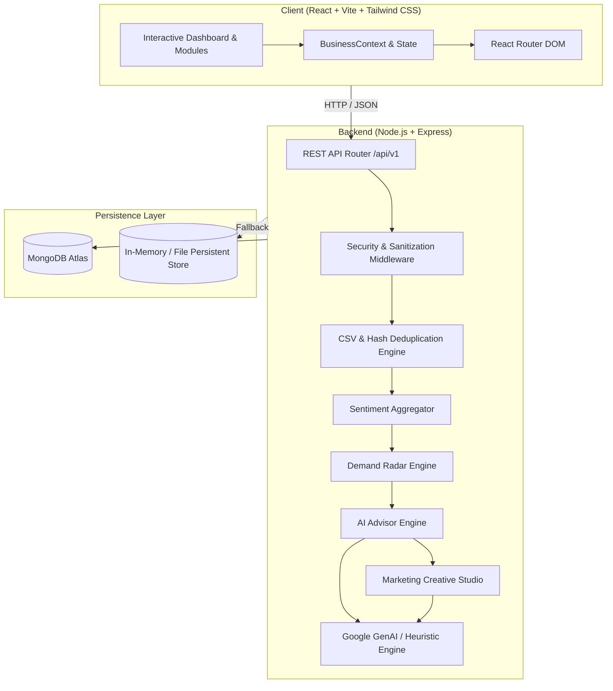
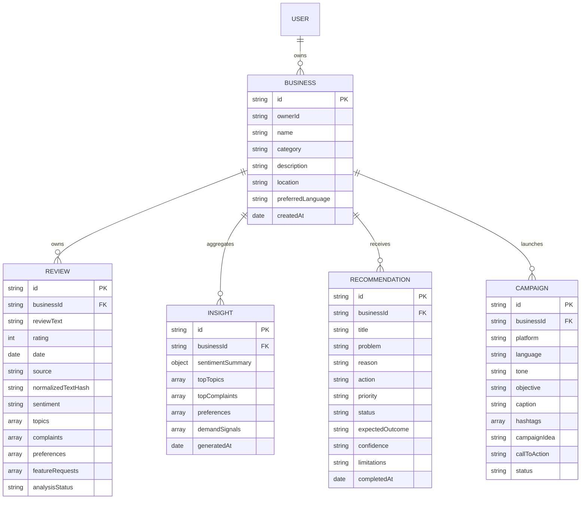
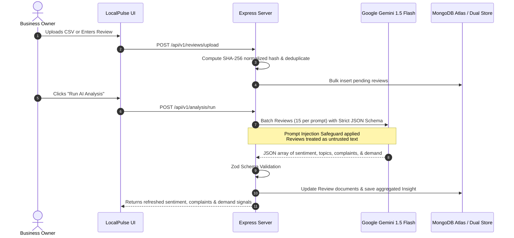

# LocalPulse AI — System Architecture & Technical Design

## 1. System Overview

**LocalPulse AI** is an AI-powered customer intelligence and business growth engine engineered for local enterprises (restaurants, salons, boutiques, and neighborhood service providers). It bridges the gap between raw customer reviews and operational execution by deriving sentiment trends, identifying friction points, detecting emerging product/service demand signals, generating pragmatic business recommendations, and producing multi-lingual marketing campaigns.

---

## 2. Database Models & ER Relationships

---

## 3. Demand Radar Scoring Engine

The differentiator of LocalPulse AI is **Demand Radar™**. Instead of merely summarizing past sentiment, it actively scans customer reviews for explicit feature requests, menu inquiries, and service gaps.

### Illustrative Heuristic Ranking Formula:
$$\text{DemandScore} = 0.4 \times F + 0.3 \times G + 0.3 \times N$$

Where:
- **$F$ (Normalized Frequency)**: The relative mention volume of the request compared to the most requested item across all reviews.
- **$G$ (Normalized Growth)**: Period-over-period velocity comparing the recent review half vs the prior review half (scores range from 30 for declining, 50 for stable, to 95 for emerging/rising).
- **$N$ (Normalized Unique Customer Count)**: Number of unique customer reviews requesting the feature, guarding against single-customer spam.

### Trend & Confidence Classifications:
- **Rising**: Mention frequency in the recent period exceeds previous period by $>25\%$.
- **Stable**: Mention frequency remains consistent across historical samples.
- **Insufficient History**: Review volume is below the time-series threshold ($<10$ total reviews).
- **Confidence Tiers**:
  - *High*: $\ge 6$ unique customer reviews across different dates.
  - *Moderate*: $3 - 5$ unique customer reviews.
  - *Exploratory*: Emerging signal with 2 reviews.

---

## 4. AI Workflow & Safeguards

### Safety & Guardrail Implementation:
1. **Prompt Injection Defense**: Customer reviews are explicitly demarcated as untrusted external strings. Instructions embedded within review text are neutralized.
2. **Strict JSON Schema Enforcement**: Gemini API is requested with `responseMimeType: "application/json"` and strict structure.
3. **Zod Validation**: Every item in the returned array is validated against `aiReviewItemSchema`. Malformed items fall back to deterministic regex extraction.
4. **Anti-Hallucination Guardrail in Marketing**: The Marketing Studio prompt explicitly forbids fabricating non-existent discount percentages or phantom sales.
